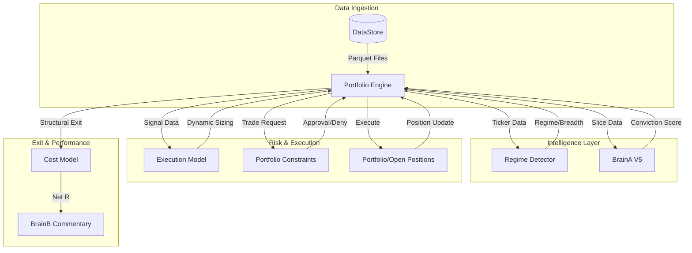

# Sovereign Trading Engine V8.0

A five-minute NSE research and signal-generation engine with deterministic scoring, portfolio simulation, risk controls, and optional alerts. The offline verification suite covers execution timing, accounting, data quality, and failure handling. This is a research/alerting system; broker order management and production certification are not implemented.

---

## 🚀 Quick Start

```bash
# 1. Use Python 3.12 in an isolated environment
python -m venv .venv
# Windows PowerShell: .\.venv\Scripts\Activate.ps1
# Linux/macOS: source .venv/bin/activate
python -m pip install -r requirements.txt
python -m pip check

# 2. Configure your Gemini API key (used for the BrainB AI commentary layer in the dashboard;
#    core signal/sizing/risk logic is fully deterministic and works without it)
cp .env.example .env
# then edit .env and set GEMINI_API_KEY=<your real key>

# 3. Run the offline test suite (no API key or network required)
python -m pytest tests/ -v

# 4. Launch the live dashboard
streamlit run src/app_v6.py
```

**Live data:** Dashboard actions fetch Yahoo data. Signal generation requires fresh, completed five-minute stock and benchmark candles and at least 80% usable universe coverage. Missing/stale data disables new signals. The daily regime display is separate from the intraday execution regime. Scanner quantities are indicative: they do not reflect a connected account or enforce its portfolio limits.

Other useful entry points:
```bash
python run_certification.py     # Backtest tearsheet across 3 benchmark tickers
python run_portfolio_sim.py     # Full-universe portfolio simulation
```

### Offline analysis and data from other folders

Audit existing market files before reusing them. This command reads source files
without modifying them or downloading data:

```powershell
python scripts/audit_local_data.py "D:\MarketData" --output research/data_audit.json
```

The five-minute strategy requires real Open, High, Low, Close, and Volume columns,
plus timestamp-aligned `^NSEI` benchmark data. Date/Datetime/Timestamp columns or a
Parquet datetime index are supported. Aware timestamps convert to IST before the
timezone is removed; naive timestamps denote IST. Invalid prices, duplicate
timestamps, missing volume, and incompatible intervals are rejected. Missing
candles are retained as gaps.

Use compatible CSV/Parquet data from one or more folders with downloads disabled:

```powershell
python run_local_backtest.py --data-dir "D:\MarketData" --data-dir "D:\OtherMarketData" --tickers RELIANCE.NS TCS.NS --start-date 2026-09-01 --end-date 2026-10-01 --output research/offline_backtest.json
```

Folders are read-only. File names are `RELIANCE.NS.parquet`,
`RELIANCE.NS_5m.csv`, or `RELIANCE.NS.csv`; the benchmark uses `^NSEI` in the
same naming scheme. Output must be outside the source folders. The Python API
also accepts `DataStore(search_dirs=[...], allow_network=False)` through
`PortfolioEngine(..., data_store=store)`. `start_date` is inclusive and `end_date`
is exclusive; warm-up history before the start is retained. Only candles
completed by the end are included. Missing requested symbols fail the run.

The 25 October 2026 cross-project audit inspected 20 saved daily OHLC histories
from `tori-scanner`. They lack volume and are incompatible with this intraday
strategy. See [the audit](research/local_data_audit.json) and
[project review](docs/project_review.md) for evidence and remaining limitations.

A subsequent read-only audit of `Finding Multibagger NSE/multibagger634-main`
found 617,654 daily OHLCV rows across 635 symbols with volume, daily benchmark
closes, and additional Fyers daily stores. No compatible five-minute histories
were identified in the inspected stores. See the [database audit](research/multibagger_data_audit.json).

Backtests use completed-bar signals and fill at the next contiguous five-minute
bar's open. Missing bars, expired signals, overnight carry, gaps, risk/reward,
cash including modeled fees, and portfolio limits are checked before entry.
Opening exits settle before new orders; later intrabar profits cannot fund an
earlier opening fill. Reports include signal/entry/exit times, quote times,
share quantities, net PnL, and rejection events.
The JSON report also includes exit-reason and long/short breakdowns, gross PnL,
modeled costs, cost per unit of initial risk, capital resizing events, largest
entry notional, and maximum simultaneous positions. The 1.5x/2x cost scenarios
hold fills and quantities fixed; they are accounting sensitivity checks.

Sector coverage is included in each local backtest report. The bundled map now
contains 501 symbols across 20 sectors, covering 199 of the 201 configured
tickers. It uses the saved NSE constituent CSV found in the other project;
[provenance](data/nse_sectors.provenance.json) records its source and hash.
`DUMMYHDLVR.NS` and `LTIM.NS` remain in the shared `OTHER` bucket pending verified
identity/classification data. Financial companies share `Financial Services`.
These are snapshot classifications, not point-in-time historical sectors.

An offline runtime benchmark is available with
`python scripts/benchmark_backtest.py --days 5 --tickers 8 --output research/data/runtime.json`.
Array-based completed-bar aggregation and RS calculations reduced the measured
runtime from 12.50 to 4.64 seconds on this workload, with identical trades and
rejection events. See the [comparison](research/runtime_comparison.json).
This synthetic benchmark measures implementation behavior, not strategy returns.

Scoring reuses prepared indicators and no longer depends on the unused EMA200.
Support/resistance come from the preceding 20 bars. A level already broken by
the completed signal close does not cap its ATR target; an unbroken level still
does. RR and stop-distance sizing are rechecked at the opening fill. See the
[scoring rubric](docs/scoring_rubric.md) for exact units and target rules.

Equity includes open PnL and estimated liquidation costs. Daily loss breaches
block entries for the rest of the session; the drawdown breaker liquidates and
stops the simulation. Repeated runs reset state. Remaining positions close at
the last observed price, with stale marks labelled. These are model assumptions,
not evidence of obtainable fills or profitability.

Default stop-distance risk is capped at 1% of current equity per trade and 5%
in aggregate. The daily loss threshold is twice the smaller of the base rupee
risk and the start-of-day equity-capped trade budget. Sector and correlated
positions also face actual stop-distance risk limits. Gaps and fees can exceed
these nominal risk amounts. Defaults are engineering controls, not calibrated
investment recommendations.

`MAX_POSITION_NOTIONAL_PCT` caps each entry's notional plus fee reserve at 20%
of equity by default. Override it per offline run with
`--max-position-notional-pct 0.20` (use `1.0` to compare the previous cash-only
allocation). This preserves capital for other positions without adding leverage;
sector, correlation, signal, and cash gates can still prevent five simultaneous
positions. Historical results need regeneration when this limit changes.

The simulator reserves full notional for both longs and shorts, plus estimated
fees, and does not model leverage or broker margin. Risk budgets are ceilings;
available capital can reduce the executed risk and number of simultaneous
positions. The 0.75–1.25 band bounds the conviction multiplier alone.

Streaming mode defaults to `MockFeed`: simulated signals cannot write trade
records or send alerts. A real feed must be injected, history seeded, and alerts
explicitly enabled. `Tick.volume` must be incremental; adapters for cumulative
volume must convert it. Streaming failures cancel tasks and disconnect the feed.
The polling bot's alert threshold is separately configurable through
`ALERT_KILL_SCORE_THRESHOLD` (default 7.0). Its banner identifies outputs as
indicative signals without broker/account risk enforcement.

### Persistent offline paper account

An explicit paper execution layer journals simulated entries, marks, exits,
positions, and loss halts transactionally in SQLite. Replaying the same event
IDs cannot duplicate fills. It uses the shared sizing, capital, cost, and
portfolio constraints, and is not connected to a broker or the live scanner.

```powershell
python run_paper_account.py --ledger research/data/paper_demo.db --events examples/paper_events.jsonl
```

The example prices are synthetic. Exits must be submitted explicitly; automatic
strategy execution, broker reconciliation, and a complete exchange calendar
remain outstanding. See [paper-account usage and limitations](docs/paper_account.md).

Run the complete offline gate with `python scripts/verify_project.py`.

---

## 🏗️ System Architecture (V8.0)

The system operates on an **Advanced Multi-Factor Risk Architecture**, decoupling data ingestion, signal generation, and risk execution.

### High-Level Component Diagram


### Data Flow Lifecycle
```mermaid
sequenceDiagram
    participant D as DataStore
    participant R as RegimeDetector
    participant B as BrainAV5
    participant E as ExecutionModel
    participant P as PortfolioEngine
    
    P->>D: Load Universe Data
    loop Five-Minute Simulation
        P->>R: Get Breadth & Regime (Nifty + Universe)
        Note right of R: V7.0 Breadth Floor: 35%
        R-->>P: Authorized Status
        P->>B: Analyze Ticker Slice
        B-->>P: Kill Score (6.0 - 10.0)
        P->>E: Generate Order (Vol, DD, Conviction)
        Note over E: Dynamic Risk Scaling
        E-->>P: Order (Shares, Entry, Stop, Target)
        P->>P: Queue signal; revalidate and fill at next open
    end
```

---

## 🦅 V8.0 Advanced Strategy Pillars

### 1. Dynamic Position Sizing (`src/execution/model.py`)
Risk is no longer fixed. Sizing scales dynamically based on:
- **Conviction Multiplier**: 0.75x to 1.25x based on Kill Score (6.0 - 10.0).
- **Drawdown Scalar**: Reduces exposure by up to 50% when approaching 15% Max DD.
- **Volatility Scalar**: Normalizes risk against a 12% annualized portfolio vol target.

```python
# Sizing Logic (ExecutionModel.calculate_dynamic_risk)
conviction = config.CONVICTION_MIN_MULT + \
            (kill_score - config.KILL_SCORE_THRESHOLD) / \
            (10.0 - config.KILL_SCORE_THRESHOLD) * \
            (config.CONVICTION_MAX_MULT - config.CONVICTION_MIN_MULT)

dd_scalar = max(0.5, 1.0 - (current_dd / config.MAX_DD_THRESHOLD) * 0.5)

annualized_vol = portfolio_vol * (252 ** 0.5)
vol_scalar = min(1.5, config.TARGET_PORTFOLIO_VOL / annualized_vol) if annualized_vol > 0 else 1.0

final_risk = self.base_risk_inr * conviction * dd_scalar * vol_scalar
# At portfolio entry: min(final_risk, equity * config.MAX_TRADE_RISK_PCT)
```

### 2. Market Breadth Intelligence (`src/regime.py`)
- **Universe Scan**: Real-time calculation of % of stocks above their 50-bar EMA.
- **Institutional Veto**: Automatically halts all long entries if breadth falls below **35%**, even if Nifty is bullish.

```python
# Breadth Score (RegimeDetector.get_breadth_score)
def get_breadth_score(self, universe_data: dict, timestamp: pd.Timestamp) -> float:
    total = 0
    above = 0
    for ticker, df in universe_data.items():
        if ticker == "^NSEI": continue
        if timestamp in df.index:
            total += 1
            if 'EMA_50' in df.columns:
                if df.loc[timestamp]['Close'] > df.loc[timestamp]['EMA_50']:
                    above += 1
    return above / total if total > 0 else 0.5
```

### 3. Structural Exit Logic (`src/backtest/position.py`)
Exits trades before they hit stop/target if the "Alpha Edge" evaporates:
- **RS Deterioration**: RS Score falls below the minimum threshold (0.05 percentage points).
- **Structure Break**: Price closes below the 20-EMA (Longs).
- **Volatility Collapse**: Realized ATR falls below 50% of entry ATR.

### 4. Real-time Notifications & Alerts (`src/notifications.py`)
- **Multi-channel Broadcast**: Telegram and Email alerting logic for institutional signal pipelines.
- **Robustness**: Fault-tolerant retries, deduplication per session, and gracefully degrades on network faults.
- **Live Hooks**: Wired into `src/live_bot.py` (the 5-minute polling bot); signals are broadcast to configured channels after being logged to `live_signals.csv`.

---

## 🔄 Project Version History

| Version | Milestone | Key Features |
| :--- | :--- | :--- |
| **V8.0** | **Institutional Live System** | Real-time multi-channel notifications (Telegram/Email), advanced structural alignments, offline regression testing. |
| **V7.2** | **Stability & State Isolation** | Fixed cross-ticker state leakage in multi-ticker runs, resolved trade report `NameError`, added engine unit tests. |
| **V7.1** | **Resilience & Safety** | BrainB UI integration, Capital & Leverage Limits, 59-day Backtest Engine dates, E2E integration testing, and 71 active tests. |
| **V7.0** | **The Quant Institutional** | Dynamic Sizing, Portfolio Vol Targeting, Market Breadth, Structural Exits. |
| **V6.5** | **Regime Sovereignty** | Unified RegimeDetector, Multi-Factor constraints, Parquet Optimization. |
| **V6.0** | **Bayesian Brain** | BrainAV5 (Kill Score logic), ATR-based stops, Multi-ticker backtesting. |
| **V5.0** | **Foundations** | Initial Portfolio Engine, Basic technical indicators, CSV data support. |

---

## 🧪 Verification & Reliability

- **Offline Regression Suite**: execution timing, nonempty trade/report integration, cash and risk limits, walk-forward boundaries, stale data rejection, streaming cleanup, and accounting reconciliation. See the dated [review](docs/project_review.md) for verification results.
- **Dynamic Sizing Tests**: Verified conviction scalars (7.5k - 12.5k risk bands).
- **Structural Exit Tests**: Verified automated exits on RS/EMA/ATR shifts.
- **Breadth Verification**: Verified veto triggers on weak market internalities.

Run full verification:
```bash
python -m pytest tests/ -v
```

---

## ⚡ Key Parameters (V8.0)

| Parameter | Value | Logic |
| :--- | :--- | :--- |
| **Annual Vol Target** | `12%` | Global portfolio stabilization |
| **Max DD Limit** | `15%` | Defensive risk scaling threshold |
| **Breadth Floor** | `35%` | Universe health requirement |
| **Gap Multiplier** | `1.5x ATR` | Volatility-aware gap protection |
| **Risk Multiplier** | `0.75 - 1.25` | Conviction-based sizing band |
| **Trade / Aggregate Risk Caps** | `1% / 5%` | Initial stop-distance exposure / equity |
| **Breadth Coverage** | `80%` | Minimum usable configured universe |

---

Production readiness still requires vetted point-in-time data, an exchange calendar, a durable order/fill ledger, broker reconciliation, operational monitoring, and controlled paper-trading validation. See [the review](docs/project_review.md).
